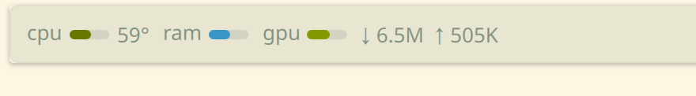
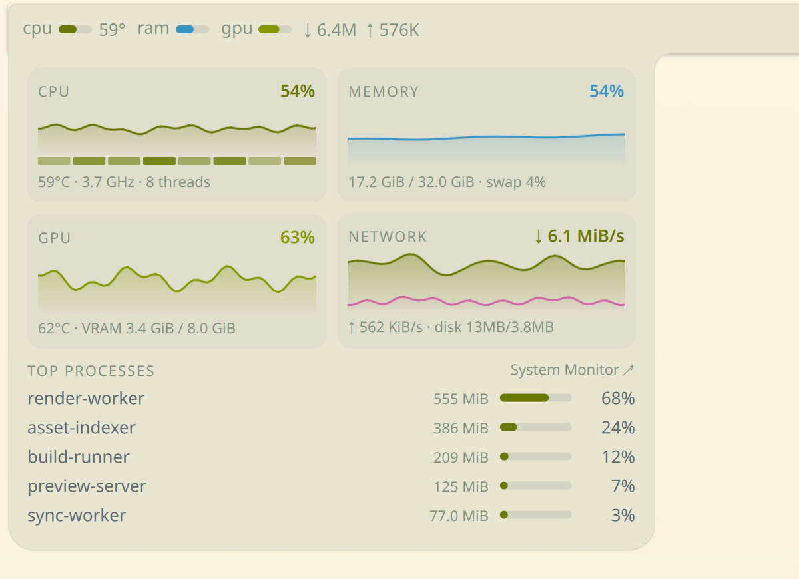

# plasma-sysbar

<picture>
  <source media="(prefers-color-scheme: dark)" srcset="docs/screenshots/panel-dark.png">
  
</picture>

Sysbar (`io.github.aethryl.sysbar`) puts hardware and network activity in your Plasma 6 panel. Click it to open the notch for a closer look.

## At a glance

- See CPU, RAM and GPU usage alongside download and upload rates in the panel.
- Follow recent activity in the notch with history graphs and a per-core load strip.
- See which processes are using the most CPU and how much memory each uses.

<picture>
  <source media="(prefers-color-scheme: dark)" srcset="docs/screenshots/notch-dark.png">
  
</picture>

*Screenshots show simulated load.*

## Requirements

- Plasma 6 (tested on 6.7.5)

## Install

```sh
git clone git@github.com:Aethryl/plasma-sysbar.git
cd plasma-sysbar
./install.sh
```

`install.sh` symlinks `plasmoid/` into `${XDG_DATA_HOME:-~/.local/share}/plasma/plasmoids/`, so edits are live. After a QML change, run `systemctl --user restart plasma-plasmashell`.

Right-click the panel, enter **Edit Mode**, choose **Add Widgets**, and add **sysbar**. The author's panel order is sysbar, claudebar, mural, then the system tray.

## Licence

MIT, see `LICENSE`.
